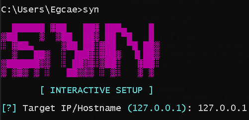
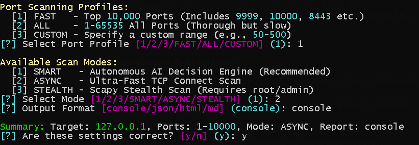
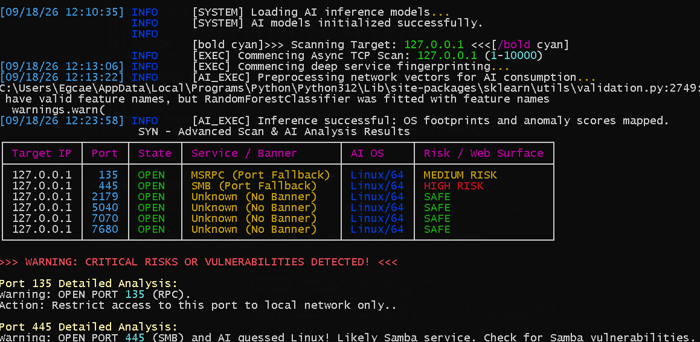

<div align="center">
  
  <h1>SYN Framework</h1>
  <p><strong>Advanced AI-Powered Autonomous Security Scanner & Pentest Framework</strong></p>

  <p align="center">
    <a href="https://www.python.org/"></a>
    <a href="https://scikit-learn.org/"></a>
    <a href="https://www.docker.com/"></a>
    <a href="LICENSE"></a>
  </p>
</div>

---

## 📖 Overview

**SYN** is an autonomous port scanner and vulnerability assessment framework powered by Machine Learning (TTL/latency OS fingerprinting & anomaly detection) and real-time CVE intelligence.

Designed for red teamers, bug bounty hunters, and penetration testers, SYN combines high-speed asynchronous TCP scanning with `scapy`-based stealth/UDP probes, dynamic jitter evasion, web attack surface inspection, and version-aware CVE lookups via the CIRCL CVE Search API backed by a local SQLite cache.

## ✨ Core Features

*   **🤖 Autonomous AI Engine (SMART Mode)**: Utilizes verified Random Forest and Local Outlier Factor models to analyze observed network vectors (TTL, Latency) and dynamically select or pivot scan modes (e.g., falling back cleanly to ASYNC without root/Npcap, or pivoting to FIN if probes are silently dropped).
*   **⚡ Ultra-Fast Asynchronous Scanning**: Implements high-performance TCP connection scans via `asyncio`, distinguishing open, closed (`RST`), and filtered (timeout) ports without requiring elevated privileges.
*   **🥷 Stealth Operations & AI Jitter**: Integrates a `scapy` engine supporting SYN, ACK, FIN, XMAS, NULL, and UDP scans with bounded thread pools, randomized source ports, and **AI Dynamic Jitter** for adaptive rate control.
*   **🌐 Version-Aware CVE & TLS Intelligence**: Queries the CIRCL CVE Search v2 API (`cve.circl.lu` CVE 5.x/NVD records) and curated static recipes only when confirmed product/version signatures exist, inspects HTTPS certificates and deprecated TLS protocols (`TLSv1.0`/`TLSv1.1`), and caches results locally in SQLite.
*   **🛡️ Flexible Targeting & Banner OS Correlation**: Scan with zero port args (`syn <target>` scans the Top 100 ports), flexible specs (`-p 22,80,443,8000-8100`), `--top-ports`, live Rich progress bars, and automatic banner/host OS hinting when non-root `ASYNC` mode runs without raw TTL.
*   **📊 Rich Terminal UI & Reporting**: Features an interactive setup wizard, sanitized Rich console tables, and XSS/injection-safe exports in JSON, HTML, and Markdown (`-o/--output`).
*   **🐳 Docker Ready**: Fully containerized environment for isolated execution with persisted cache, logs, and reports.

---

## 📸 Screenshots & Workflow

### 1. Interactive Setup Wizard
Provides an intuitive, colorized CLI wizard to quickly configure targets, port profiles, and scan modes.
<div align="center">
  
</div>

### 2. Engine Initialization & AI Analysis
Loads the machine learning models and initializes the OODA (Observe, Orient, Decide, Act) loop for target analysis.
<div align="center">
  
</div>

### 3. Example Terminal Output (CLI)
For a text-based preview of the tool in action, expand the section below:

<details>
<summary><b>Click to view the full raw terminal output</b></summary>

```console
C:\Users\Egcae>syn

  ██████ ▓██   ██▓ ███▄    █
▒██    ▒  ▒██  ██▒ ██ ▀█   █
░ ▓██▄     ▒██ ██░▓██  ▀█ ██▒
  ▒   ██▒  ░ ▐██▓░▓██▒  ▐▌██▒
▒██████▒▒  ░ ██▒▓░▒██░   ▓██░
▒ ▒▓▒ ▒ ░   ██▒▒▒ ░ ▒░   ▒ ▒

       [ INTERACTIVE SETUP ]

[?] Target IP/Hostname (127.0.0.1): 127.0.0.1

Port Scanning Profiles:
  [1] FAST   - Top 10,000 Ports (Includes 9999, 10000, 8443 etc.)
  [2] ALL    - 1-65535 All Ports (Thorough but slow)
  [3] CUSTOM - Specify a custom range (e.g., 50-500)
[?] Select Port Profile [1/2/3/FAST/ALL/CUSTOM] (1): 1

Available Scan Modes:
  [1] SMART   - Autonomous AI Decision Engine (Recommended)
  [2] ASYNC   - Ultra-Fast TCP Connect Scan
  [3] STEALTH - Scapy Stealth Scan (Requires root/admin)
[?] Select Mode [1/2/3/SMART/ASYNC/STEALTH] (1): 2
[?] Output Format [console/json/html/md] (console): console

Summary: Target: 127.0.0.1, Ports: 1-10000, Mode: ASYNC, Report: console
[?] Are these settings correct? [y/n] (y): y

    [ SYN ENGINE INITIALIZATION ]

[09/18/26 12:10:35] INFO     [SYSTEM] Loading AI inference models...
                    INFO     [SYSTEM] AI models initialized successfully.
                    INFO
                             [bold cyan]>>> Scanning Target: 127.0.0.1 <<<[/bold cyan]
                    INFO     [EXEC] Commencing Async TCP Scan: 127.0.0.1 (1-10000)
[09/18/26 12:13:06] INFO     [EXEC] Commencing deep service fingerprinting...
[09/18/26 12:13:22] INFO     [AI_EXEC] Preprocessing network vectors for AI consumption...
[09/18/26 12:23:58] INFO     [AI_EXEC] Inference successful: OS footprints and anomaly scores mapped.
                     SYN - Advanced Scan & AI Analysis Results
┌───────────┬──────┬───────┬───────────────────────┬──────────┬────────────────────┐
│ Target IP │ Port │ State │ Service / Banner      │ AI OS    │ Risk / Web Surface │
├───────────┼──────┼───────┼───────────────────────┼──────────┼────────────────────┤
│ 127.0.0.1 │  135 │ OPEN  │ MSRPC (Port Fallback) │ Linux/64 │ MEDIUM RISK        │
│ 127.0.0.1 │  445 │ OPEN  │ SMB (Port Fallback)   │ Linux/64 │ HIGH RISK          │
│ 127.0.0.1 │ 2179 │ OPEN  │ Unknown (No Banner)   │ Linux/64 │ SAFE               │
│ 127.0.0.1 │ 5040 │ OPEN  │ Unknown (No Banner)   │ Linux/64 │ SAFE               │
│ 127.0.0.1 │ 7070 │ OPEN  │ Unknown (No Banner)   │ Linux/64 │ SAFE               │
│ 127.0.0.1 │ 7680 │ OPEN  │ Unknown (No Banner)   │ Linux/64 │ SAFE               │
└───────────┴──────┴───────┴───────────────────────┴──────────┴────────────────────┘

>>> WARNING: CRITICAL RISKS OR VULNERABILITIES DETECTED! <<<

Port 135 Detailed Analysis:
Warning: OPEN PORT 135 (RPC).
Action: Restrict access to this port to local network only.

Port 445 Detailed Analysis:
Warning: OPEN PORT 445 (SMB) and AI guessed Linux! Likely Samba service. Check for Samba vulnerabilities.
Action: Samba service may be vulnerable. Check version and update.
[09/18/26 12:24:00] INFO     [SYSTEM] Execution halted. Scan complete.
```
</details>

---

## 📦 Installation

### Option 1: Docker (Recommended for Stealth Scans)
Running via Docker ensures all `scapy` dependencies (like `tcpdump` and `libpcap`) are perfectly isolated.
```bash
git clone https://github.com/egnake/syn.git
cd syn
docker-compose up --build
```
*Note: `docker-compose.yml` uses `network_mode: "host"` with `NET_RAW`/`NET_ADMIN` capabilities for Linux stealth scans; on Windows/macOS Docker Desktop, use `--mode ASYNC` or run natively with Administrator + Npcap.*

### Option 2: Local Installation (Requires Python 3.10+)
If you prefer running it locally on your host machine:
```bash
git clone https://github.com/egnake/syn.git
cd syn
pip install -e .
```

---

## 🛠️ Usage

SYN defaults to its **Interactive Wizard** if no arguments are provided. Simply type `syn` in your terminal:

```bash
syn
```

### Advanced CLI Arguments

For automated pipelines or power users, SYN supports direct execution:

```bash
# Quick scan (defaults to Top 100 common TCP ports)
syn 192.168.1.1

# Flexible port selection (-p supports lists and ranges)
syn 192.168.1.1 -p 22,80,443,8000-8100 --mode ASYNC

# Scan Top N common ports with custom timeout and quiet output
syn scanme.nmap.org --top-ports 25 --timeout 2.0 -q --report json -o scan_results.json

# Autonomous AI Scan on a classic positional range
syn 192.168.1.1 1 1000 --mode SMART

# Include OSINT subdomain discovery via crt.sh
syn example.com -p 80,443 --mode ASYNC --subdomains

# Stealth TCP SYN Scan (Requires Root/Admin Privileges + libpcap/Npcap)
sudo syn 10.0.0.5 1 65535 --mode S
```

### Supported Scan Modes

| Mode | Description | Privileges Required |
|:---:|---|:---:|
| **SMART** | Autonomous AI Decision Engine. Analyzes initial state and pivots dynamically. | User / Root |
| **ASYNC** | Ultra-fast concurrent TCP connect scan. | User |
| **S** | TCP SYN Stealth Scan (Half-open scanning). | **Root** |
| **A** | TCP ACK Scan (Used for firewall mapping). | **Root** |
| **F** | TCP FIN Scan (Bypasses stateless firewalls). | **Root** |
| **X** | TCP XMAS Scan (Lights up the packet like a Christmas tree). | **Root** |
| **N** | TCP NULL Scan (No flags set). | **Root** |
| **U** | UDP Scan (Detects stateless UDP services). | **Root** |

### Output Formats

Generate comprehensive reports using the `--report` flag:
- `console`: Rich terminal output (Default)
- `json`: Machine-readable JSON output
- `html`: Beautifully styled HTML report
- `md`: Markdown format for easy sharing

---

## 🏗️ Architecture Under the Hood

1. **Reconnaissance & Expansion**: Resolves domains, performs subdomain enumeration via OSINT, and executes initial host discovery.
2. **AI Pre-Processing (OODA Loop)**: Initial stealth probes measure TTL and Latency.
3. **Inference**: The Scikit-Learn Random Forest and Anomaly Detection models classify the host (Windows/Linux/Custom) and score the network anomaly.
4. **Execution Pivot**: Based on the AI decision, SYN automatically switches to the optimal scan payload (e.g., Async, Stealth, FIN).
5. **Deep Fingerprinting**: Grabs banners and analyzes HTTP web surfaces dynamically.
6. **Vulnerability Assessment**: Queries the local NVD cache and live API for CVEs matching the grabbed banners.

---

## ⚠️ Disclaimer

**SYN Framework** is developed exclusively for educational purposes and authorized professional penetration testing. The author assumes no liability and is not responsible for any misuse, damage, or unauthorized access caused by this tool. **Always obtain explicit, written authorization before scanning any network or system.**

---

## 👤 Author
Developed by **Egnake**.
